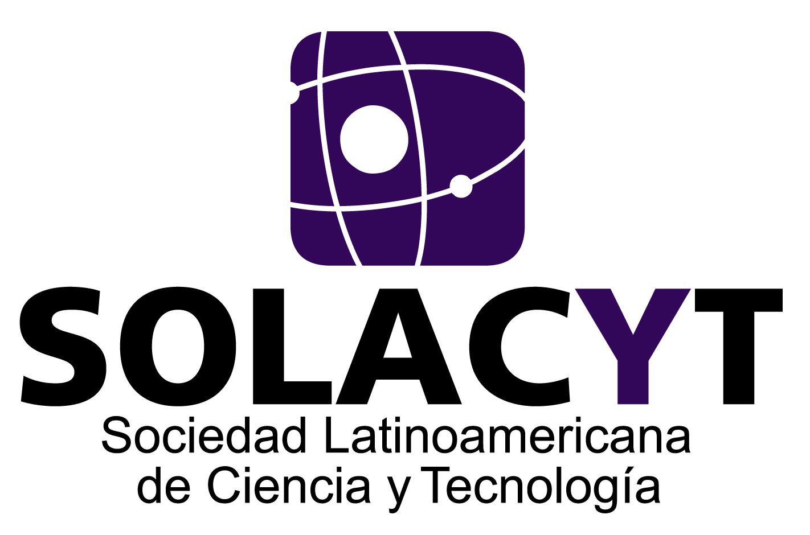

<p>
  
  
</p>
<br clear="both" />

<p align="center"></p>

# Puente Salud · web ciudadanía

Aplicación web responsive (móvil primero) para la **persona** (paciente o cuidador): en qué paso va, cuál es el siguiente, dónde atenderse y qué hacer ante una emergencia. Las instrucciones completas, la arquitectura y los datos están en el [README principal del backend](https://github.com/Alejandrin08/puente-salud-backend#readme).

**En línea:** [puente-salud-web-ciudadania.vercel.app](https://puente-salud-web-ciudadania.vercel.app) (folio `PS081368`, código `246810`). La API está en [gateway-production-bb185c96.up.railway.app](https://gateway-production-bb185c96.up.railway.app/docs).

Investigación que sustenta el proyecto: [`docs/investigacion.md`](docs/investigacion.md).

## Pantallas
1. **Bienvenida y consentimiento** (`/bienvenida`): acceso con folio y código de demostración, y aceptación del uso de datos.
2. **Inicio** (`/`): el arco de 4 pasos y el siguiente paso en lenguaje claro.
3. **Mi recorrido** (`/recorrido`): etapas con fecha y lo que ha pasado.
4. **Mapa de atención** (`/mapa`): centros de salud y ferias, con lista (funciona sin sesión).
5. **Señales de alarma** (`/alarma`): 911, signos de alarma y urgencias cercanas (funciona sin sesión).

**Demostración:** folio `PS081368` (paso 2), `PS000877` (paso 4, fuera de meta), `PS119662` (en control) o `PS077861` (sin consentimiento), todos con el código `246810`. Todos los datos de personas son simulados.

## Desarrollo
```
cp .env.example .env      # VITE_API_URL apunta al gateway
npm install
npm run dev               # http://localhost:5173
```

## Pruebas
```
npm test                  # unitarias (Vitest + Testing Library)
npm run test:e2e          # extremo a extremo + accesibilidad (Playwright + axe); requiere el sistema levantado
```
La primera vez: `npx playwright install chromium`.

## Despliegue (Vercel)
Proyecto Vite. Variable `VITE_API_URL` = URL pública del gateway en Railway. `vercel.json` reescribe las rutas a `index.html`.
